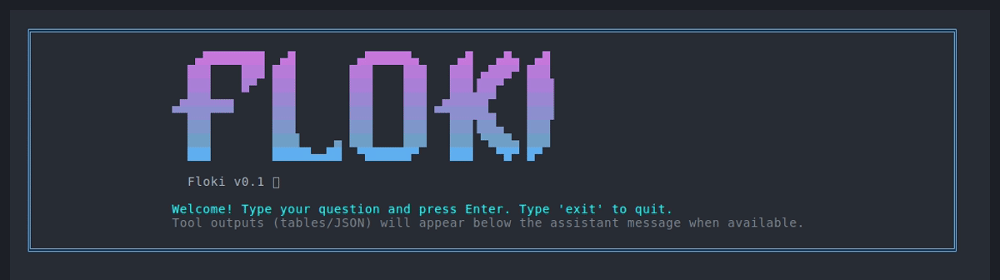
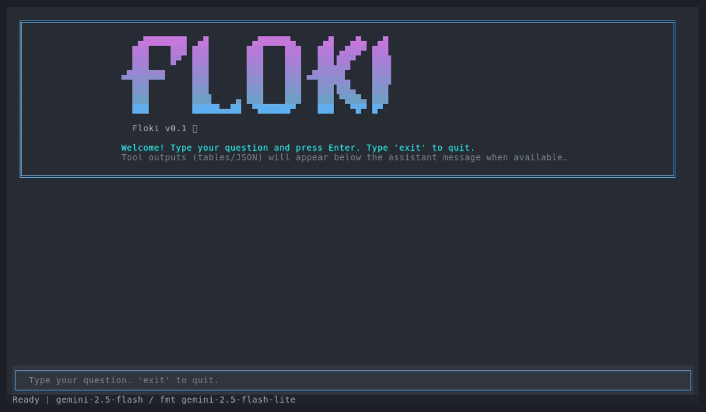

# Floki 🧭 — MLflow Experiment Agentic Chatbot



> **⚠️ Work in Progress:** This project is actively being developed. Features, structure, and documentation may change frequently.

Floki is named after the legendary Viking engineer Flóki Vilgerðarson, who built innovative boats that enabled Vikings to explore new lands. This project aims to empower ML researchers to explore their experiment logs with the same spirit of discovery.

A CLI-based assistant for ML experimentation, inspired by Claude Code, that helps researchers query, analyze, and gain insights from MLflow experiment logs.

**Demo**
> One Dark TUI: welcome banner, tool-verb status animation, and structured answer blocks.



## Quick Setup

### 1) Create and activate an environment

Option A — Conda (recommended):

```bash
bash setup_env.sh
conda activate ./mlflow_agentic_env
```

Or create manually:

```bash
conda env create -f environment.yml -p ./mlflow_agentic_env
conda activate ./mlflow_agentic_env
pip install -r requirements.txt
```

Option B — venv + pip:

```bash
python -m venv .venv
source .venv/bin/activate
pip install -r requirements.txt
```

### 2) Add required API keys

Create a `.env` file in the project root or export the variables into your shell. The agent expects at least the following keys:

```
GEMINI_API_KEY=your_gemini_api_key_here
LANGFUSE_PUBLIC_KEY=your_langfuse_api_key_here
LANGFUSE_SECRET_KEY=your_langfuse_api_key_here
LANGFUSE_BASE_URL="https://us.cloud.langfuse.com"
```

Model configuration lives in `config.json` under `llm`:

- `gemini_model` — agent LLM for tool calling (default: `gemini-2.5-flash`)
- `formatter_model` — formatter LLM for structured UI output (default: `gemini-2.5-flash-lite`)

The agent runs in two phases: first it calls MLflow tools and drafts an answer, then the formatter produces a structured `BlockResponse` for rendering.

### 3) Run the agent

From the project root:

```bash
bash run_agent.sh
```

Or directly:

```bash
python src/app.py --tui
```

Legacy Rich REPL:

```bash
python src/app.py --repl
```

Type your question and press Enter. Type `exit` or `quit` to leave.
